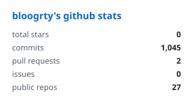
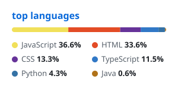
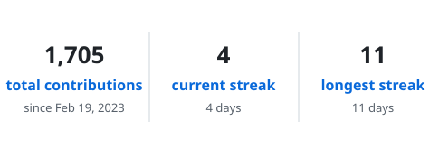

<div align="center">


</div>

<!-- TERMINAL:START -->
```console
$ whoami
bloogrty

$ uptime
up 3 years, 10 months, still building...

$ ls projects/ | wc -l
22

$ cat motivation.txt
if it works, don't touch it.
if it doesn't, git blame.

$ echo $MOOD
coffee && code

$ git log -1 --oneline
last push: project-memories-friends (2 hours ago)
```
<!-- TERMINAL:END -->

## 🛠 Stack

| area | tools |
| --- | --- |
| **frontend** |       |
| **database** |   |
| **api** |    |
| **tools** |   |
| **also speaks** |   |

## 📂 Recently worked on

<!-- PROJECTS:START -->
| project | what it is | lang | updated |
| --- | --- | --- | --- |
| [project-memories-friends](https://github.com/Bloogrty/project-memories-friends) | _no description yet_ | TypeScript | 2 hours ago |
| [qa-tools](https://github.com/Bloogrty/qa-tools) | _no description yet_ | JavaScript | 1 month ago |
| [snake](https://github.com/Bloogrty/snake) | _no description yet_ | Python | 1 year ago |
| [higher-or-lower](https://github.com/Bloogrty/higher-or-lower) | _no description yet_ | Python | 1 year ago |
| [guess-number](https://github.com/Bloogrty/guess-number) | _no description yet_ | Python | 1 year ago |
| [blackjack](https://github.com/Bloogrty/blackjack) | _no description yet_ | - | 1 year ago |
| [auction](https://github.com/Bloogrty/auction) | _no description yet_ | - | 1 year ago |
| [caesar-cipher](https://github.com/Bloogrty/caesar-cipher) | _no description yet_ | - | 1 year ago |

<sub>last refreshed 2026-11-07 · [see all repos](https://github.com/bloogrty?tab=repositories)</sub>
<!-- PROJECTS:END -->

## 🧩 Practice

[](https://github.com/bloogrty/leetcode__python)
[](https://github.com/bloogrty/Leetcode-30-Days)
[](https://github.com/bloogrty/codewars__python)
[](https://github.com/bloogrty/CodeWars-S2)

## 📊 Stats

<div align="center">






</div>

---

<sub>`questionable-decisions/` is private. for now.</sub>
